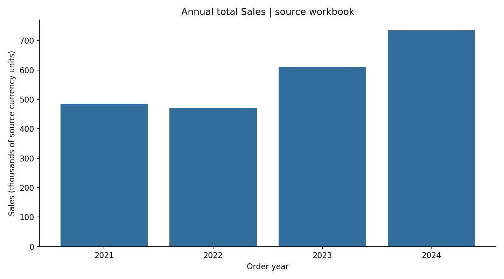

# Sales Overview | Power BI and Reproducible Analysis

**Business question:** How do sales totals and profit margins vary by year and region, and how do those results differ from average sales per order line?

This portfolio project preserves the original Power BI dashboard and adds a reproducible Python analysis of the exact workbook already in the repository. The documentation and validation improvements were developed with AI assistance.

## Verified workbook findings

- **10,018 order lines**, representing **5,026 distinct order IDs**, dated 3 January 2021 to 30 December 2024.
- Total Sales: **2,298,896.62** source currency units; average Sales per order line: **229.48**. They answer different questions and must not share a metric label.
- 2024 total Sales: **733,948.35**, up **20.3%** from 2023 in this workbook.



This figure was generated by the Python analysis; it is not a Power BI screenshot. The existing Slide1/2/3 images are layout assets, and the inspected Slide1 image does not contain populated report visuals.

## Metric definitions

| Metric | Calculation | Meaning |
|---|---|---|
| Total Sales | SUM(Sales) | Additive Sales across the selected order lines |
| Mean Sales per order line | AVERAGE(Sales) | Average line value; not average order value |
| Distinct orders | COUNT DISTINCT Order ID | One order can contain multiple rows |
| Profit margin | SUM(Profit) / SUM(Sales) | Count-weighted source margin; not the average of row margins |
| Sales YoY | Current total / previous total - 1 | Compare equivalent date coverage; first year has no prior value |

The earlier README described averages for its current/previous-year measures. Those PBIX measures have not been independently evaluated here. The new summary explicitly uses total Sales and does not silently relabel the existing dashboard calculations.

## Worked example

**Question:** How much did total Sales change between 2023 and 2024?

```python
annual = df.groupby(pd.to_datetime(df['Order Date']).dt.year)['Sales'].sum()
change_pct = (annual.loc[2024] / annual.loc[2023] - 1) * 100
```

**Result:** 609,861.32 to 733,948.35 source currency units, **20.3% growth**. These are order-line sums, not mean line values.

**Interpretation:** inspect product, region, quantity and discount mix before attributing growth to a particular strategy. The workbook alone does not establish causation or current business performance.

## Reproduce

Python 3.11 is the automated validation target:

```bash
python -m venv .venv
source .venv/bin/activate
python -m pip install -r requirements-ci.txt
python ci_validate.py
```

Windows: activate with `.venv\Scripts\activate`. The script checks the original workbook fingerprint, unique row IDs, required fields, quantities and reconciliation of annual/regional totals. [Validation runs](https://github.com/Kelv-Ojo/Dashboard-sales/actions/workflows/validate.yml) · [Environment and reproduction notes](REPRODUCIBILITY.md).

## Original Power BI artifact

[Download salesoverview.pbix](salesoverview.pbix). Open it in Power BI Desktop to inspect the existing year/region slicers and measures. The PBIX is unchanged and has not been refreshed or verified in Power BI Desktop during this review. No live report or repaired DAX is claimed.

## Data source and limits

[Sales Overview Data.xlsx](Sales%20Overview%20Data.xlsx), Sales Data sheet, is the workbook already committed to this repository. The local copy was matched byte-for-byte to that GitHub file before analysis. [Source fingerprint and computed metrics](reports/metrics.json) · [Annual results](reports/annual_sales.csv) · [Regional results](reports/region_sales.csv) · [Detailed findings](reports/findings.md).

The original dataset publisher, currency and data licence have not been verified. No upstream provenance or currency symbol is inferred from the filename or schema. This project reports only the supplied fields; it does not claim audited revenue, profit accounting, realized savings or a client engagement. An earlier README stated MIT licensing; a corresponding licence file was not present at review, so no licence grant is newly asserted here.
