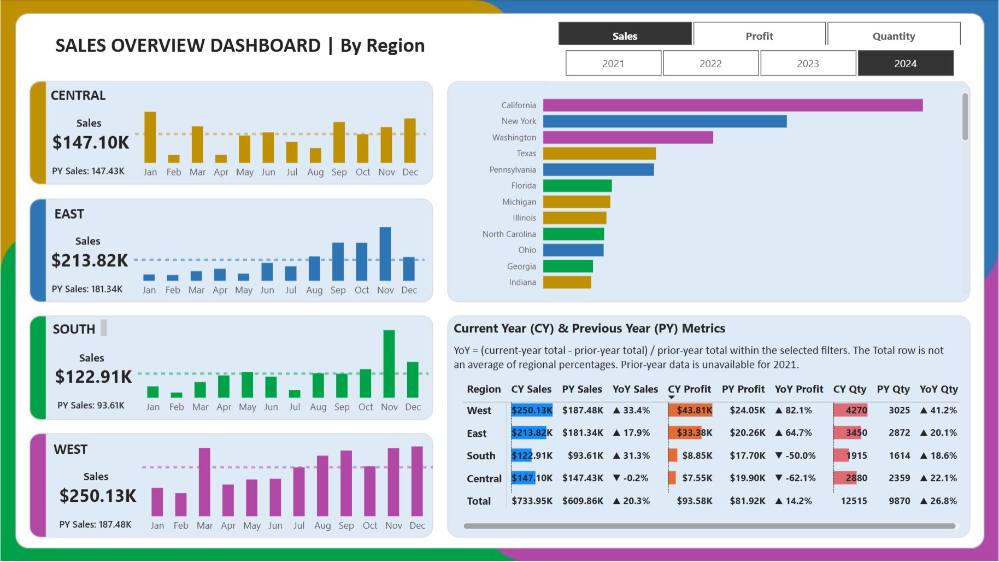
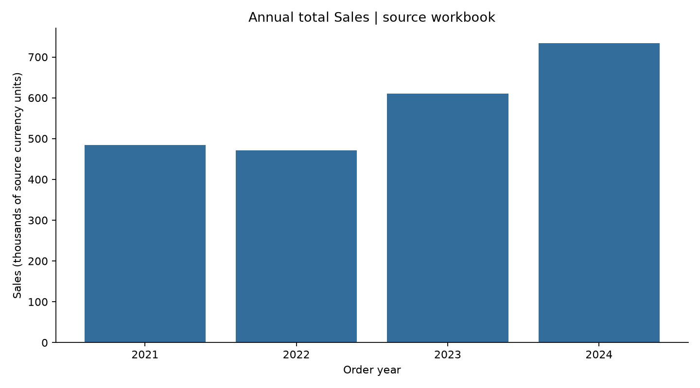

# Sales Overview | Power BI and Reproducible Analysis

**Start here:** [Original PBIX](salesoverview.pbix) → [Python annual totals](reports/annual_sales.csv) → [metric definitions](#metric-definitions)

[Verified findings](#verified-workbook-findings) · [Metric definitions](#metric-definitions) · [Reproduce](#reproduce) · [Original Power BI artefact](#original-power-bi-artifact) · [Data limits](#data-source-and-limits)

**Business question:** How do sales totals and profit margins vary by year and region, and how do those results differ from average sales per order line?

This portfolio project preserves the original Power BI dashboard and adds a reproducible Python analysis of the exact workbook already in the repository. The documentation and validation improvements were developed with AI assistance.


## Visual evidence



Actual Power BI Desktop screenshot of the separately saved repaired review copy, Sales and 2024 selected. Dollar formatting is inherited; currency remains unverified. The original PBIX is preserved.



Independently rebuilt Python chart of annual source-workbook Sales totals. This chart is distinct from the native dashboard above.

Images are static previews. Open them at full size for detail; follow the reproduction notes to inspect the underlying work.


## Verified workbook findings

- **10,018 order lines**, representing **5,026 distinct order IDs**, dated 3 January 2021 to 30 December 2024.
- Total Sales: **2,298,896.62** source currency units; average Sales per order line: **229.48**. They answer different questions and must not share a metric label.
- 2024 total Sales: **733,948.35**, up **20.3%** from 2023 in this workbook.

This figure was generated by the Python analysis; it is not a Power BI screenshot. The existing Slide1/2/3 images are layout assets, and the inspected Slide1 image does not contain populated report visuals.

## Metric definitions

| Metric | Calculation | Meaning |
|---|---|---|
| Total Sales | SUM(Sales) | Additive Sales across the selected order lines |
| Mean Sales per order line | AVERAGE(Sales) | Average line value; not average order value |
| Distinct orders | COUNT DISTINCT Order ID | One order can contain multiple rows |
| Profit margin | SUM(Profit) / SUM(Sales) | Sales-weighted source margin; not the average of row margins |
| Sales YoY | Current total / previous total - 1 | Compare equivalent date coverage; first year has no prior value |

The original PBIX was inspected in Power BI Desktop. Its base Sales measure uses SUM, and its CY/PY measures filter the selected/prior year. Its YoY Sales measure evaluates a ratio from these totals; the original on-canvas statement that total YoY is an average is incorrect and is corrected in the separate review copy. See the [native verification and outstanding issues](docs/POWER-BI-VERIFICATION.md).

## Worked example

**Question:** How much did total Sales change between 2023 and 2024?

```python
annual = df.groupby(pd.to_datetime(df['Order Date']).dt.year)['Sales'].sum()
change_pct = (annual.loc[2024] / annual.loc[2023] - 1) * 100
```

**Result:** 609,861.32 to 733,948.35 source currency units, **20.3% growth**. These are order-line sums, not mean line values.

**Interpretation:** inspect product, region, quantity and discount mix before attributing growth to a particular strategy. The workbook alone does not establish causation or current business performance.

## Reproduce

Python 3.11 is the automated validation target:

```bash
python -m venv .venv
source .venv/bin/activate
python -m pip install -r requirements-ci.txt
python ci_validate.py
```

Windows: activate with `.venv\Scripts\activate`. The script checks the original workbook fingerprint, unique row IDs, required fields, quantities and reconciliation of annual/regional totals. [Validation runs](https://github.com/Kelv-Ojo/Dashboard-sales/actions/workflows/validate.yml) · [Environment and reproduction notes](REPRODUCIBILITY.md).

## Original Power BI artifact

[Download salesoverview.pbix](salesoverview.pbix). Open it in Power BI Desktop to inspect the metric/year slicers, region-filtered visuals and measures. The PBIX is unchanged on disk. Desktop checks confirmed imported-model counts, Sales totals, key Sales DAX and selected slicer behaviour. PY cards stay on Sales when Profit/Quantity is selected, the YoY explanatory text is incorrect, and the map is disabled in this environment. A separate [repaired review copy](salesoverview-reviewed-20261030.pbix) now corrects these comparison cards, the total-YoY text and missing-prior-year percentage displays. It replaces the unavailable map area with a working state comparison. The original remains unchanged. See [scoped Desktop checks](docs/LOCAL-REVIEW-20261030.md); exhaustive validation is not claimed.

## Data source and limits

[Sales Overview Data.xlsx](Sales%20Overview%20Data.xlsx), Sales Data sheet, is the workbook already committed to this repository. The local copy was matched byte-for-byte to that GitHub file before analysis. [Source fingerprint and computed metrics](reports/metrics.json) · [Annual results](reports/annual_sales.csv) · [Regional results](reports/region_sales.csv) · [Detailed findings](reports/findings.md).

The original dataset publisher, currency and data licence have not been verified. No upstream provenance or currency symbol is inferred from the filename or schema. This project reports only the supplied fields; it does not claim audited revenue, profit accounting, realized savings or a client engagement. An earlier README stated MIT licensing; a corresponding licence file was not present at review, so no licence grant is newly asserted here.


## Portfolio review notes

The Python chart and numbers reconcile to the supplied workbook; they do not validate every PBIX measure. The Slide images are blank layout assets, so do not call them populated dashboard screenshots. A genuine Desktop screenshot with filter context is now included above. The repaired local copy is checked in the documented 2021/2024 states; establish currency/upstream rights and complete the remaining filter audit before release. Avoid presenting total Sales, mean line value and average order value under the same label.

## Business context and skills

A reporting team needs consistent definitions of sales, orders and order lines before interpreting growth. The workbook supports historical totals; the source currency and commercial provenance remain unverified; native DAX checks are scoped in the review notes.

**Skills demonstrated:** Power BI report presentation; Python workbook reconciliation; KPI grain and denominator checks; sales-trend communication.

## Release status

**Hold the complete dashboard release** until the remaining source-data rights/privacy questions and exhaustive review items in the [Desktop verification](docs/POWER-BI-VERIFICATION.md) are resolved. The independently checked workbook metrics remain valid within their documented scope.
